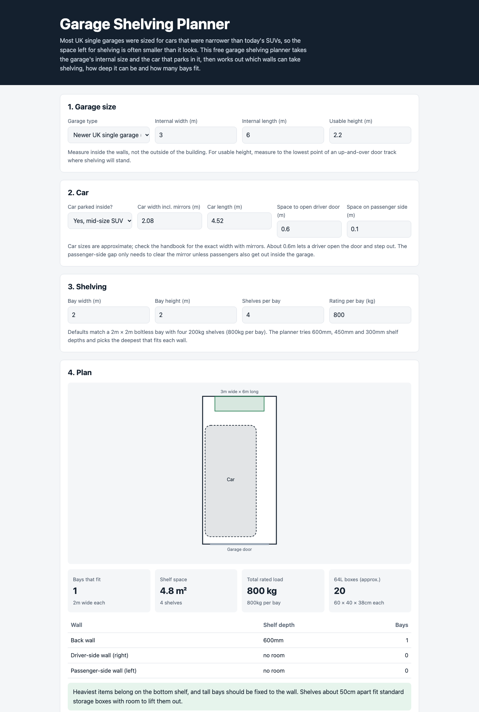

# Garage Shelving Planner – How Much Shelving Fits a UK Garage

A free, open-source **garage shelving planner** for UK garages. Enter the garage's internal size and the car that parks in it, and the planner works out which walls can take shelving, how deep the shelves can be, how many bays fit and roughly how many storage boxes they hold.

**Live planner:** https://rackingoutlet.github.io/garage-shelving-planner/ (also on [rackingoutlet.co.uk](https://rackingoutlet.co.uk/garage-shelving-planner/?utm_source=github&utm_medium=referral&utm_campaign=garage_shelving_planner&utm_content=readme))

## What it works out

- **Which walls take shelving**: back wall, passenger side and driver side, keeping the driver door clear (UK right-hand-drive layout)
- **Shelf depth per wall**: the deepest of 600mm, 450mm or 300mm that fits
- **Number of bays** for any bay width (default 2m)
- **Total shelf area, rated load and approximate 64L box count**
- **Warnings** when the car and door space leave no room, the bay is taller than the usable height, or shelves are too close for standard boxes
- A **top-down plan** of the garage, car and shelving

## Garage size presets

| Preset | Internal size | Basis |
|---|---|---|
| Older UK single garage | about 2.4m × 4.9m | [Homebuilding & Renovating](https://www.homebuilding.co.uk/advice/garage-size) |
| Newer UK single garage | 3m × 6m | Common council parking standard, e.g. [North Lanarkshire](https://www.northlanarkshire.gov.uk/sites/default/files/2023-12/Residential%20Parking%20Provision.pdf) |
| Long single garage | 3m × 7m | e.g. [Essex Design Guide](https://www.essexdesignguide.co.uk/design-details/2024-essex-parking-guidance/residents-parking/) |

Car widths with mirrors (Ford Puma 1.93m, Kia Sportage 2.08m, Tesla Model Y 2.13m) come from [Direct Line Group, 2024](https://www.directlinegroup.co.uk/en/news/brand-news/2024/20112024.html). Lengths are approximate.

## Garage shelving FAQ

### How deep should garage shelves be?

Where a car parks alongside, 300mm to 450mm deep shelving usually fits without blocking the doors, and it suits paint tins, tools and small boxes. On the back wall, or in a garage used only for storage, 600mm deep shelving holds a standard 64L storage box lengthways and makes better use of the floor. The planner checks each wall and picks the deepest of 600mm, 450mm or 300mm that fits.

### How high should garage shelves be?

Freestanding garage bays are commonly around 1.8m to 2m tall, but the real limit is the lowest point of the ceiling or an up-and-over door track where the shelving stands. Inside the bay, shelves about 40cm to 50cm apart fit standard storage boxes with room to lift them out, and the heaviest items belong on the bottom shelf.

### What are standard single garage dimensions in the UK?

There is no single national minimum. Many older single garages measure roughly 2.4m wide by 4.9m long inside. Newer council parking standards often expect 3m by 6m internally before a garage counts as a parking space, and some councils, such as Essex, ask for 3m by 7m.

### Can a car and shelving both fit in a single garage?

Often only on the back wall. A 3m wide garage holding a mid-size SUV around 2.08m wide with mirrors, plus about 0.6m to open the driver door, leaves roughly 0.2m spare, which is not enough for side shelving. Smaller cars can leave room for 300mm shelving on the passenger side. Entering the car's real width and length into the planner gives a wall-by-wall answer.

## Related tool

- [Shelving load calculator](https://github.com/rackingoutlet/shelving-load-calculator): checks the weight on each shelf against the shelf and bay rating.

## Run it locally

No build step and no dependencies. Download `index.html` and open it in a browser. Inputs are saved in the browser's local storage only.

## About

Built and maintained by [RackingOutlet](https://rackingoutlet.co.uk/?utm_source=github&utm_medium=referral&utm_campaign=garage_shelving_planner&utm_content=readme), a Manchester supplier of [800kg heavy duty boltless shelving](https://rackingoutlet.co.uk/product/heavy-duty-metal-shelving-800kg-capacity/?utm_source=github&utm_medium=referral&utm_campaign=garage_shelving_planner&utm_content=readme) and author of [garage shelving ideas for UK garages](https://rackingoutlet.co.uk/garage-shelving-ideas-uk/?utm_source=github&utm_medium=referral&utm_campaign=garage_shelving_planner&utm_content=readme).

The planner is a guide only. Measure the garage and car, and follow the shelving manufacturer's instructions.

## Licence

MIT
